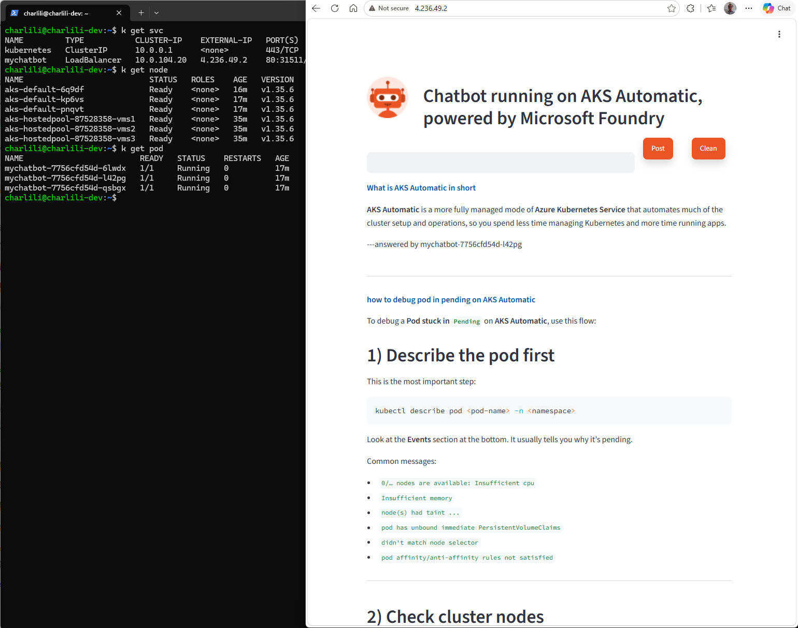

# Microsoft Foundry chatbot on AKS Automatic

This sample provisions an AKS Automatic cluster, a Microsoft Foundry resource with a chat model deployment, and a Streamlit chatbot. AKS Automatic provides a managed cluster configuration with node provisioning, scaling, and workload identity enabled by default. The pod exchanges its projected Kubernetes service-account token for a Microsoft Entra token; no model API key is stored in Kubernetes.

The same container deployment, workload identity, and autoscaling foundation can also host MCP servers and AI agents that call Microsoft Foundry from AKS Automatic. See [mcp-server-foundry](mcp-server-foundry/README.md) for a sample that hosts an MCP server backed by Microsoft Foundry. Dedicated AI agent samples are coming soon.



The sample is configured to use subscription `c582d154-33c4-47e4-a3c2-0632d20b12eb` and create resources in `westus3` under `charlili-rg`. Resource names, location, model, and capacity are defined in `set-variables.sh`. Foundry account and container registry names are globally unique, so change them if the configured names are unavailable.

## Prerequisites

- Azure CLI authenticated with permission to create AKS, ACR, Cognitive Services, managed identities, federated credentials, and role assignments
- Azure CLI support for `az aks create --sku automatic`
- `kubectl` and `yq`
- Azure AI model access and quota for the model, region, SKU, and capacity configured in `set-variables.sh`

Local Docker is not required. The `06-build-container-image.sh` script uses an Azure Container Registry cloud build to build and push the image. Docker is needed only for the optional local `debug-mychatbot.sh` workflow.

## Deploy with Microsoft Foundry

Run the scripts from the repository root in this order:

```bash
./01-create-aks-cluster.sh
./02-create-acr.sh
./03-create-foundry.sh
./04-create-managed-identity.sh
./05-create-service-account.sh
./06-build-container-image.sh
./07-push-image-to-acr.sh
./08-deploy-mychatbot.sh
```

The `01-create-aks-cluster.sh` script creates the cluster with the AKS Automatic SKU and disables SSH access. AKS Automatic selects and manages compute capacity rather than using a fixed node VM size or node count defined in this repository. The `04-create-managed-identity.sh` and `05-create-service-account.sh` scripts connect the Kubernetes service account to a user-assigned managed identity and authorize it to call Foundry.

Get the public endpoint after the load balancer is ready:

```bash
export KUBECONFIG=/tmp/kubeconfig
kubectl get service mychatbot --namespace default --watch
```

Open the external IP address in a browser over HTTP. Use `debug-mychatbot.sh` to run the image locally with credentials from the host's Azure CLI cache.

The setup creates an `AIServices` Foundry resource, deploys `gpt-5.4-mini`, and assigns the `Cognitive Services User` role to the workload identity. The deployed chatbot calls the Foundry `/models` endpoint by using `azure-ai-inference`.

## Cleanup

```bash
./09-cleanup.sh
```

The cleanup script deletes the Foundry resource and the resource groups configured in `set-variables.sh`. Review it before running if those groups contain resources not created by this sample.

## License

This project is licensed under the [MIT License](LICENSE).
